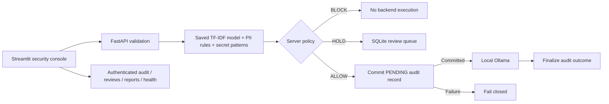
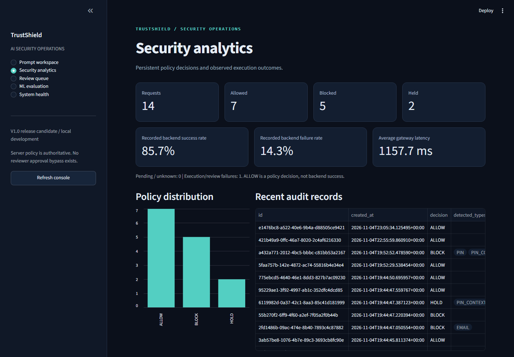

# TrustShield AI Gateway

A local AI security gateway and ML engineering portfolio project: inspect prompts, enforce privacy policy before execution, retain metadata-only evidence, and measure where the detector fails.

**V1.0 release candidate. Local development scope; not production-grade privacy protection.** The software control flow is tested, but the classifier has substantial generalization failures. No independently collected holdout exists. No model or threshold was promoted during release preparation.

## Problem and approach

A local LLM still receives whatever its caller sends. TrustShield puts a server-side enforcement boundary between the caller and Ollama. A lightweight TF-IDF/logistic classifier, contextual rules, and credential patterns produce explainable decisions. SQLite preserves review tickets and audit outcomes without storing prompt or response text.



## Implemented capabilities

- SAFE / REVIEW / SENSITIVE analysis and secret-first ALLOW / HOLD / BLOCK enforcement.
- Original-offset redaction, including compatibility-width matching; incomplete detection is explicitly documented.
- Pre-forward persistent audit, controlled failure responses, Windows-safe SQLite connections, bounded request sizes.
- HOLD visibility and local reject/rewrite actions. There is **no approval override**; rewritten inputs pass all checks again.
- Dark operations console: prompt workspace, persistent analytics, read-only review queue, measured ML comparisons, downstream health.
- Opt-in draft warnings on committed edit (blur/Ctrl+Enter), using analysis-only preview. This is not per-keystroke streaming or an Ollama request.
- Leakage audits, provenance/annotation/freeze tooling, calibration and contextual experiments, synthetic robustness probes.
- Separate non-root API/dashboard containers, persistent data volume, pinned dependency lock, GitHub Actions regression/build configuration.

Python, FastAPI, Pydantic, scikit-learn, pandas, NumPy, SQLite, HTTPX, Streamlit, Ollama, unittest, Docker Compose. Optional matplotlib and isolated Playwright tooling support experiments and browser verification.

## Measured ML results

See [experiment methodology](docs/ml-experiments.md), [machine-readable results](reports/ml_experiments.json), and [dataset reliability audit](reports/dataset_reliability.md). Matrices use rows true SAFE/SENSITIVE and columns predicted SAFE/positive. Hybrid positive means **withheld**, including REVIEW, not confirmed disclosure.

| Dataset / system | n | Precision | Recall | F1 | FPR | FNR |
|---|---:|---:|---:|---:|---:|---:|
| Legacy validation / hybrid | 117 | .548 | .678 | .606 | .569 | .322 |
| Legacy test / saved ML only | 117 | .548 | .690 | .611 | .559 | .310 |
| Legacy test / hybrid | 117 | .571 | .759 | .652 | .559 | .241 |
| Legacy test / contextual experiment | 117 | .965 | .948 | .957 | .034 | .052 |
| Synthetic validation / hybrid | 10 | 1.000 | 1.000 | 1.000 | .000 | .000 |
| Synthetic validation / contextual experiment | 10 | 1.000 | .800 | .889 | .000 | .200 |

These are development-exposed datasets with uncertain historical lineage and source/label confounding. The contextual model is a frozen local nomic-bert encoder plus an experimental logistic head, **not the deployed detector**. Its small-data advantage does not establish an independent winner. Three-way outcomes, per-category results and other datasets are in JSON. REVIEW is abstention; counting it as positive measures withholding rather than classification accuracy.

Sigmoid calibration changed legacy-test Brier .242975 to .243190 and log loss .678890 to .679331: neither improved. Production remains unchanged. The independent holdout is **NOT_READY**: zero examples, registered sources, annotations or frozen snapshots. Existing freeze floors remain 300 resolved examples and 30 connected groups per class, with two source tracks.

## Windows installation

Use Python 3.14 (verified locally) or 3.13 (verified Linux container). From the repository root:

```powershell
py -3.14 -m venv .venv
.\.venv\Scripts\python.exe -m pip install -r requirements.lock
# Fresh clone only: deterministic public synthetic fixtures, never private holdout data.
.\.venv\Scripts\python.exe src/split_v02_synthetic.py
.\.venv\Scripts\python.exe src/build_v02_hard_examples.py
.\scripts\start-local.ps1 -Service Initialize
.\scripts\start-local.ps1 -Service Api
```

In a second PowerShell terminal:

```powershell
.\scripts\start-local.ps1 -Service Dashboard
```

The launcher stores only a Windows DPAPI-encrypted monitoring token in ignored .env.monitoring, tied to your Windows user/machine, and supplies it to both processes without printing it. Stop with Ctrl+C and restart both commands after code/configuration changes. Never commit this file. The existing saved artifact is loaded when present; a fresh clone without private artifacts uses the documented synthetic development training fallback. It does not reproduce the private artifact or historical evaluation corpora. Never load untrusted joblib files.

Install Ollama separately, then:

```powershell
ollama pull llama3.2:1b
ollama list
Invoke-RestMethod http://127.0.0.1:11434/api/tags
```

Ollama must be running. The launcher does not start it. API: http://127.0.0.1:8000/docs ; console: http://127.0.0.1:8501 . Monitoring requires bearer authentication plus an allowed actual peer address. Missing token configuration yields 503; configured but unauthorized requests yield 401. Do not paste tokens into browsers or command histories.

## Docker Desktop (Linux containers)

```powershell
.\.venv\Scripts\python.exe -m src.devtools container-secret
docker compose config --quiet
docker compose up --build -d --wait
```

Stop competing Windows services first, or use alternate loopback ports:

```powershell
$env:TRUSTSHIELD_API_PORT='18000'
$env:TRUSTSHIELD_DASHBOARD_PORT='18501'
docker compose up --build -d --wait
```

The image builds an explicitly labeled **public synthetic demo model**, not the protected production artifact. Reports from the original experiment are displayed as archival measurements with a runtime mismatch warning. Raw datasets, private holdout evidence, weights and Windows DPAPI material are excluded from build context. SQLite persists in the named `trustshield_audit_data` volume. `docker compose down` preserves it; do not add `--volumes` unless you intend to delete audit history.

Compose mounts ignored .secrets/audit_token as a read-only secret file. This is plaintext on the host, not an encrypted secret manager: protect its ACL and backups. On Linux, grant only the intended container UID 1000 read access. Do not bake credentials into images. See [deployment/security boundaries](docs/threat-model.md).

Host Ollama is reached through host.docker.internal, not Linux host networking. Docker Desktop host connectivity was checked locally; other hosts/firewalls may require explicit configuration. Do not expose Ollama or the gateway publicly to fix connectivity. The fixed private subnet can conflict with existing networks; change the subnet and monitoring CIDR together if necessary.

## API and policy

| Route | Purpose |
|---|---|
| GET /, /health | Service information / API liveness |
| POST /analyze | Privacy classification; no generation |
| POST /redact | Best-effort span redaction; no generation |
| POST /preview | Draft analysis and policy; never forwards or persists a request |
| POST /gateway | Enforced deterministic demo backend |
| POST /gateway/local | Enforced actual Ollama generation |
| GET /audit?limit=50 | Authenticated persistent counts and metadata, bounded to 200 |
| GET /reviews?status=PENDING | Authenticated metadata-only review visibility |
| GET /reports | Authenticated allowlisted integrity-checked aggregate reports |
| GET /operations/health | Authenticated API, Ollama, model, audit and review health |

POST bodies contain one strict nonblank `text` string, at most 20,000 characters; HTTP bodies are limited to 96 KiB. Validation and unexpected errors do not echo inputs. BLOCK/HOLD never invoke the backend. An ALLOW requires a committed PENDING record before execution. A finalization failure after generation cannot undo the remote action: the response fails conservatively and the remaining PENDING row exposes uncertainty. No retry silently duplicates execution.

## Demonstration and tests

```powershell
.\.venv\Scripts\python.exe -W error::ResourceWarning -m unittest discover -s tests -v
.\.venv\Scripts\python.exe -m src.demo
.\.venv\Scripts\python.exe -m src.demo --live
.\scripts\start-local.ps1 -Service Verify
.\.venv\Scripts\python.exe -m src.release_checks
git diff --check
```

The deterministic demo injects analysis outcomes to prove control flow, committed audit ordering, blocked/held non-execution, reviewer rejection, backend failure and persistence. It is **not** an ML benchmark or fake LLM interaction. --live separately requires a real API and Ollama and prints only metadata. Review an actual ticket locally with python -m src.review_cli list, then python -m src.review_cli reject --id <ticket-id> or rewrite; no approval operation exists.

130 regression tests passed on Windows Python 3.14 and source-only Linux Python 3.13 during release preparation. See [verification evidence](docs/release-verification.md) for commands, limitations and deployment checks. GitHub CI has been configured; no remote CI run is claimed. It needs no personal token, GPU, Ollama, private dataset or DPAPI. Local contextual experiments require the installed encoder and protected development data; they are not part of CI.

## Console and genuine screenshots



[ML console](reports/screenshots/console-4.png), [system health](reports/screenshots/console-5.png), and [mobile workspace](reports/screenshots/console-mobile.png) were captured from a running console with fictional traffic. Aggregate counts evolve as requests are made. Recreate screenshots with the optional isolated Playwright instructions in [reproducibility](docs/reproducibility.md). Do not capture prompts, responses, tokens or private annotations.

## Security limitations and next steps

This is a single-user, loopback development system. Analysis/gateway endpoints do not have end-user identity or rate limiting; dashboard access itself is not authenticated. Monitoring bearer authentication is not multi-user authorization. No TLS termination, distributed audit durability, retention scheduler, encrypted SQLite, signed model registry, comprehensive Unicode/secret coverage, or downstream prompt-injection defense is claimed. Redaction is incomplete. A SAFE prediction can be wrong; fail-closed **routing** is not perfect **detection**.

Release research priorities are trustworthy human-sourced holdout collection, stronger provenance, confidence intervals and external evaluation before any promotion. Further experiments can investigate multilingual/span models, broader obfuscation coverage, selective risk control and drift detection. Do not treat generated development probes as independent data. See [holdout protocol](docs/independent-holdout.md), [annotation guidelines](docs/holdout-annotation.md), [architecture](docs/architecture.md), [threat model](docs/threat-model.md), and [interview guide](docs/interview-guide.md).
